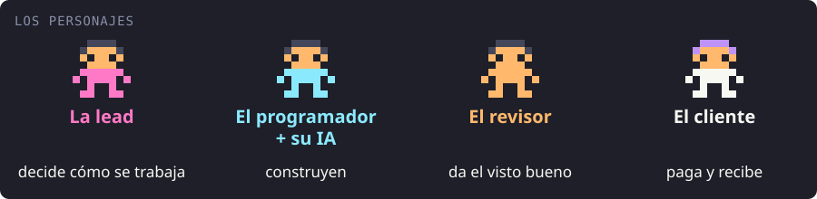
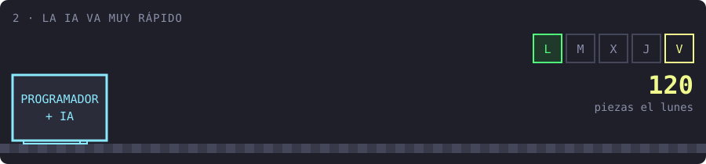
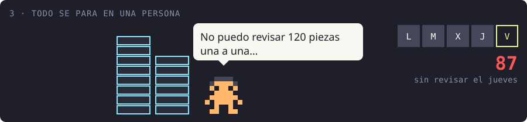

# lead-flow

**La IA pone la velocidad. El flujo hace que llegue al cliente.**

`lead-flow` (nombre provisional) es un flujo de trabajo para equipos que programan con IA, pensado
para startups y consultoras que entregan software a sus clientes. Siempre decide una persona, la
lead engineer. Las personas revisan donde hay riesgo, y lo demás se vigila sin frenar a nadie.

> **Estado:** `lead-flow` está en construcción (fase 1) y todavía no se puede usar. Lo que ya se
> puede instalar hoy es el kit `equipo-solo` para Claude Code. Detalle en
> [Qué existe hoy y qué no](#qué-existe-hoy-y-qué-no).

## La historia, en un minuto



Una consultora tiene que entregarle a un cliente su tienda online.



El plazo es el viernes. Con IA, debería sobrar tiempo.



El lunes la IA ya ha construido 120 piezas de la tienda. La IA construye mucho más rápido de lo
que el equipo puede revisar.<br>
*Para el equipo técnico: un agente puede abrir decenas de pull requests en una jornada.*



Pasan los días y el revisor no da abasto. La velocidad de la IA se pierde aquí.<br>
*Dato: en una encuesta encargada por GitLab, el 85 % de los encuestados coincide en que el atasco
ya no es escribir código, sino revisarlo y validarlo.*



Para llegar, se revisa a medias. Se entrega el lunes siguiente, el pago falla y nadie puede
enseñarle al cliente qué se hizo.<br>
*Dato: en las pruebas de Veracode, con más de 100 modelos, el código generado tuvo fallos de
seguridad del OWASP Top 10 en el 45 % de los casos. Y en la encuesta de Qodo, solo el 45 % de los
líderes de ingeniería puede rastrear qué cambios de código vienen de la IA.*


La misma semana, con el flujo. El filtro detiene el fallo del pago antes de que llegue a nadie. El
revisor solo mira lo que importa. Se entrega el viernes.<br>
*Para el equipo técnico: puertas obligatorias en CI, revisión humana según el riesgo, y la lead
aprueba los cambios del flujo.*



Si el cliente pide pruebas, recibe el informe de cada pieza: quién la pidió, quién la hizo y con
qué modelo de IA (según lo declara el equipo), qué comprobó el filtro automático, qué fallo se
corrigió antes de entregar, quién la revisó y quién la aprobó.

**La misma semana, en una tabla**

| | Sin flujo | Con flujo |
|---|---|---|
| Entrega | Lunes siguiente | Viernes |
| Revisado a mano | 120 piezas, a medias | 14 importantes, a fondo |
| Fallo del pago | Lo descubre el cliente | Parado antes de entregar |
| ¿Qué hizo la IA? | Nadie lo sabe | Un informe por pieza |


*Ejemplo ilustrativo. La tienda, los días y las cifras de la historia (120 piezas, 87 sin
revisar, 14 importantes) están inventados para explicar la idea: no son datos medidos. La historia
cuenta cómo está diseñado `lead-flow`, que todavía está en construcción. Los datos reales están en
la sección siguiente. Las escenas se generan con `node assets/historia/fuente/generar.mjs`.*

## El problema, con datos

La IA escribe código muy rápido, pero esa velocidad se pierde en dos sitios antes de llegar al
cliente:

1. **El atasco de la revisión.** Todo acaba en una persona que no da abasto. El trabajo se para
   ahí, o se revisa a medias y se cuelan fallos.
2. **La falta de pruebas para el cliente.** Cuando pregunta «¿qué ha hecho la IA en mi proyecto?»,
   nadie puede enseñárselo.

Lo que dicen los estudios:

- **El 97 % de los encuestados ya usa asistentes de IA para programar, y solo el 30 % tiene un
  gobierno completo de esa adopción.** Encuesta a 831 profesionales de empresas de 500 empleados o
  más, hecha en marzo de 2026. Encuesta de un proveedor de herramientas.
  ([Black Duck, 2026](https://news.blackduck.com/2026-06-09-AI-Coding-Hits-97-Enterprise-Adoption-New-Black-Duck-Study-Shows-Governance-Is-the-ROI-Multiplier))
- **El 85 % de los encuestados coincide en que el cuello de botella ya no es escribir código, sino
  revisarlo y validarlo.** Encuesta de The Harris Poll a 1.528 desarrolladores y compradores de
  tecnología de seis países. Encuesta encargada por un proveedor de herramientas.
  ([GitLab, 2026](https://about.gitlab.com/press/releases/2026-06-23-gitlab-research-reveals-organizations-are-generating-ai-code-faster-than-they-can-control-it/))
- **En las pruebas de Veracode, el código generado tuvo fallos de seguridad en el 45 % de los
  casos.** Análisis de 80 tareas de código con más de 100 modelos, buscando vulnerabilidades de la
  clasificación OWASP Top 10 (la lista de referencia de los fallos de seguridad web más comunes).
  Mide esas pruebas, no todo el código hecho con IA. Estudio de un proveedor de herramientas.
  ([Veracode, 2025](https://www.veracode.com/press-release/ai-generated-code-poses-major-security-risks-in-nearly-half-of-all-development-tasks-veracode-research-reveals/))
- **Menos de la mitad de los líderes de ingeniería (45 %) puede rastrear qué cambios de código
  vienen de la IA.** Encuesta a 500 desarrolladores de EE. UU. y 300 líderes de ingeniería.
  Encuesta de un proveedor de herramientas.
  ([Qodo, 2026](https://www.qodo.ai/state-of-ai-code-quality-report/))
- **La IA amplifica lo que ya hay en la organización: sin controles sólidos, más cambios generan
  más inestabilidad.** Informe de investigación DORA (Google Cloud), con casi 5.000 profesionales.
  ([DORA 2025, Google Cloud](https://cloud.google.com/blog/products/ai-machine-learning/announcing-the-2025-dora-report))

Las encuestas miden lo que opinan sus encuestados, no hechos medidos, y varios de estos editores
venden herramientas relacionadas. Cada cifra, con lo que mide exactamente y su fuente, está en
[`doc/investigacion.md`](doc/investigacion.md).

## Cómo funcionará

Así está diseñado `lead-flow`. Nada de esto funciona todavía: la columna «Fase» dice en qué fase
llega cada pieza.

| Pieza | Qué hará | Fase |
|---|---|---|
| **La lead decide, en una entrevista** | <ul><li>Una herramienta de terminal le preguntará tema por tema: tecnología, seguridad, dependencias, ramas y revisión.</li><li>Le enseñará las opciones con sus pros, sus contras y la documentación oficial, **sin recomendar ninguna**.</li><li>Cada decisión quedará escrita en el repositorio, con su porqué, la fecha y quién la tomó.</li></ul> | 1 |
| **Puertas automáticas que bloquean la integración** (con GitHub Team o en repositorios públicos; sin ello, avisan) | Cada pull request pasará pruebas, búsqueda de secretos (claves o contraseñas olvidadas en el código), análisis estático de seguridad y revisión de dependencias. Con una puerta en rojo no se podrá integrar, y las reglas del flujo solo las cambiará la lead. | 1 |
| **Aprobación según el riesgo** | <ul><li>Bajo: se integra solo y sale en el parte de la stand-up, donde cualquiera puede pedir revisarlo.</li><li>Medio: lo aprueba un compañero que no sea el autor.</li><li>Alto (autenticación, pagos, migraciones, datos personales y lo que añada la lead): QA o la persona en quien delegue la lead.</li></ul> | 1 |
| **Excepciones que decide la lead** | Si un programador necesita algo no previsto, como una librería nueva, lo pedirá en una incidencia. Si le bloquea, saldrá arriba en el parte; si no, se dejará para la próxima ceremonia. Decidirá la lead, que podrá dar un permiso temporal hasta esa ceremonia, y la decisión quedará registrada. | 1 |
| **Informe interno por ticket** | Se hará con evidencias (el resultado de cada puerta, quién revisó y quién aprobó) y no con lo que el agente dice de sí mismo. Será lo que se le enseñe al cliente si pide pruebas. | 1 |
| **Parte diario** | Cada mañana mostrará lo que se integró sin revisión de una persona. En la fase 2, además, lo que está parado: pull requests vetadas, excepciones pendientes, revisiones que esperan demasiado y el tiempo de respuesta de la lead, para que ella no se convierta en el nuevo atasco. | 1 y 2 |
| **Control de calidad por muestreo** | Una persona revisará al azar una parte de lo que se integró solo, como el control de calidad de una fábrica. | 2 |
| **Resumen para el cliente** | Un borrador en lenguaje de negocio, que prepara el sistema y que la lead revisa y envía ella. Nunca saldrá nada al cliente sin una persona. | 2 |
| **Métricas** | Entregas a tiempo, fallos que llegan al cliente, carga de revisión humana y tiempo de respuesta de la lead. | 2 |
| **Revisión con agentes y con dos modelos** | Opcional. Agentes de IA que revisan cada cambio y, si la lead lo activa, dos modelos de proveedores distintos: uno implementa y el otro revisa, para que no compartan los mismos puntos ciegos. | 2 |

**Con cualquier agente.** Cada programador podrá trabajar con el agente que quiera (Claude Code,
Codex, Cursor, Copilot, Devin…) dentro de un marco que no puede cambiar. El control vivirá en
GitHub (ramas protegidas, responsables de código y comprobaciones obligatorias), no en el agente. Al
agente solo se le contarán las reglas por adelantado, para que las conozca antes de empezar.

**Los controles no dependen de la IA.** Primero van las comprobaciones automáticas de siempre
(pruebas, secretos, análisis estático, dependencias). La revisión con agentes será opcional, por
coste y por privacidad del código del cliente.

**Palabras que salen en este documento**

- **Pull request:** la propuesta de cambio que se revisa antes de integrarla en el proyecto.
- **CI** (integración continua): las comprobaciones que GitHub ejecuta solo en cada pull request.
- **Puerta:** una de esas comprobaciones; si falla, el cambio no entra.
- **Rama protegida:** la versión principal del proyecto, donde nadie integra nada sin pasar las puertas.
- **Responsables de código:** las personas que GitHub exige que aprueben los cambios de ciertas carpetas (en `lead-flow`, la de las reglas).
- **Análisis estático:** revisar el código en busca de fallos sin ejecutarlo.
- **Stand-up:** la reunión diaria corta del equipo.
- **Ceremonia:** las reuniones fijas del trabajo ágil (planificación, revisión, retrospectiva).
- **Incremento:** un trozo pequeño de trabajo que funciona de principio a fin.

## Qué existe hoy y qué no

| Qué | Estado |
|---|---|
| Kit `equipo-solo` para Claude Code | **Disponible.** Agentes para especificar, implementar, pasar puertas de seguridad, rendimiento y diseño, y cerrar cada incremento. Pensado para quien programa solo. |
| `lead-flow`, fase 1 · núcleo en GitHub | **En construcción.** Entrevista, política del proyecto, puertas en CI, aprobación por riesgo, excepciones, informe por ticket y parte diario de lo integrado sin persona. Todavía no se puede usar. |
| Fase 2 · visibilidad | Pendiente. Parte completo de bloqueos, muestreo de calidad, resumen para el cliente, métricas y revisión con agentes y con dos modelos. |
| Fase 3 · presentación | Pendiente. Vídeo, guía de adopción y repositorio de ejemplo público. |
| Fase 4 · GitLab | Pendiente. Las mismas piezas sobre GitLab. |

Un límite que conviene saber desde ya: GitHub solo obliga a cumplir la protección de ramas y los
responsables de código en repositorios públicos o, en los privados, con el plan Team o superior.
Sin eso, `lead-flow` funcionará en modo aviso (las puertas se ejecutan pero no bloquean) y lo dirá
claramente.

### Probar hoy el kit `equipo-solo`

Necesitas Claude Code. Desde una terminal:

```bash
claude plugin marketplace add fernando-delrio/lead-flow
claude plugin install equipo-solo@equipo-solo
```

Abre una sesión nueva y comprueba con `/agents` que los agentes aparecen con el prefijo
`equipo-solo:`. Para adaptarlo a tu proyecto, copia `plugin/AGENTS.template.md` a la raíz de tu
repositorio como `AGENTS.md` y `plugin/CLAUDE.template.md` como `CLAUDE.md`, y rellena sobre todo
cómo se prueba tu proyecto: los agentes ejecutan esos comandos. El flujo completo, el porqué de
cada decisión y sus límites están en [`plugin/doc/FLUJO.md`](plugin/doc/FLUJO.md).

## Para quién será

Para startups y consultoras que programan con IA y entregan software a clientes.

| Quién | Qué sacará |
|---|---|
| **La lead engineer** | Decidirá cómo se trabaja y revisará lo importante. El parte diario le avisará si ella misma se convierte en el atasco. |
| **Los programadores** | Conocerán las reglas antes de empezar, usarán el agente que prefieran y pedirán excepciones con una plantilla. |
| **La dirección** | Verá plazos, bloqueos y fallos con datos del propio repositorio (fase 2). |
| **El cliente** | Recibirá un resumen de lo entregado (fase 2) y, si pide pruebas, el informe de cada pieza. |

## ¿Te interesa?

¿Quieres probar `lead-flow` en tu equipo cuando esté lista la fase 1? Sigue el repositorio
(**Watch → Custom → Releases**) o [abre una incidencia](https://github.com/fernando-delrio/lead-flow/issues/new)
contando tu caso.

## Para saber más

- [`plugin/doc/FLUJO.md`](plugin/doc/FLUJO.md): el flujo del kit `equipo-solo`, sus decisiones y sus fuentes.
- [`specs/001-control-del-lead/diseno.md`](specs/001-control-del-lead/diseno.md): el diseño completo de `lead-flow`.
- [`doc/investigacion.md`](doc/investigacion.md): las cifras verificadas, con lo que mide cada una.

## Licencia y autor

Apache License 2.0 (texto completo en [`LICENSE`](LICENSE), atribución en [`NOTICE`](NOTICE)).
Puedes usarlo, modificarlo y distribuirlo, también en proyectos comerciales, conservando el aviso
de copyright. Se ofrece «tal cual», sin garantía de ningún tipo.

Autor: Fernando del Río.
